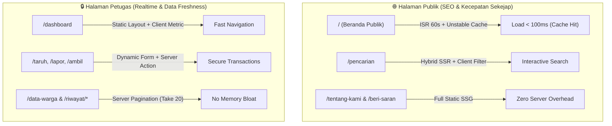

# 📱 ROADMAP OPTIMASI PERFORMA & RESPONSIVITAS MOBILE (LACAK SAAS)

> **Dokumen Perencanaan Teknis & Analisis Arsitektur**  
> Disusun berdasarkan analisis mendalam codebase Next.js 16 (App Router) dan referensi UI Mobile App.

---

## 🧭 Executive Summary: Visi Perombakan

Tujuan utama dari roadmap ini adalah:
1. **Performa Sekejap (*Instant Loading*)**: Menyesuaikan strategi rendering (`ISR`, `SSG`, `SSR Dinamis`) sesuai peran masing-masing halaman sehingga halaman publik secepat e-commerce modern (sub-second FCP), sementara halaman petugas tetap aman dan realtime.
2. **Pengalaman Mobile-First (*App-Like Experience*)**: Mengadaptasi UX aplikasi mobile modern seperti pada gambar referensi (Bottom Navigation Bar, horizontal scrolling filter chips, compact search bar, dan bottom sheet modals) tanpa merusak tampilan desktop yang sudah ada.

---

## ⚡ BAGIAN 1: Analisis Kebutuhan & Strategi Loading Tiap Halaman

Setiap halaman di LACAK memiliki karakteristik audiens dan kebutuhan performa yang berbeda:



### 1.1. Matriks Strategi Rendering & Caching

| Rute Halaman | Target Pengguna | Kebutuhan Utama | Strategi Rendering Saat Ini | Rekomendasi Optimasi Performa | Target Kecepatan |
|---|---|---|---|---|---|
| **`/` (Beranda)** | Publik & Siswa | SEO maksimal, TTFB instan, Zero Lag | ISR (`revalidate = 60`) | 1. Tambah index DB `(status, createdAt)`<br>2. Cache master data di level server (`unstable_cache`)<br>3. Optimasi lazy-loading gambar | **< 150ms** |
| **`/pencarian`** | Publik & Warga | Pencarian cepat, filter akurat | Server Fetch all (100 item) | 1. Terapkan pagination bertahap (12–24 per batch)<br>2. Skeleton placeholder saat filter berubah | **< 200ms** |
| **`/tentang-kami`** | Publik | Profil pengembang, informasi institusi | Server Component | 1. Ganti gambar eksternal Unsplash 3000px dengan WebP lokal terkompresi<br>2. Kompres `jas-hujan.jpg` (908KB -> 40KB) | **< 100ms** |
| **`/beri-saran`** | Publik & Siswa | Kirim aspirasi & feedback | Client Component | 1. Form statis ringan, tidak perlu query DB | **< 100ms** |
| **`/dashboard`** | Petugas | Ringkasan cepat aksi LACAK | Server Component | 1. Pertahankan link prefetch modul utama | **< 150ms** |
| **`/taruh`, `/lapor`, `/ambil`** | Petugas | Input data akurat, audit trail | `force-dynamic` | 1. Pertahankan dynamic (cegah data basi)<br>2. Cache pemeriksaan role di JWT token agar tidak menembak API Clerk berulang | **< 300ms** |
| **`/data-warga`** | Petugas | Kelola data warga & identifikasi | `force-dynamic` (fetch ALL) | 1. **Ubah unbounded query menjadi cursor/offset pagination (`take: 25`)**<br>2. Search warga di database PostgreSQL | **< 250ms** |
| **`/riwayat/*`** | Petugas | Pantau histori temuan/laporan/klaim | `force-dynamic` (fetch ALL) | 1. Tambah limit pagination (`take: 20`)<br>2. Tambah index DB pada foreign keys & timestamp | **< 250ms** |

---

## 📱 BAGIAN 2: Analisis UI Mobile ala "Mobile App" (Sesuai Gambar Referensi)

Berdasarkan screenshot referensi aplikasi mobile yang Anda berikan, berikut perbandingan dan rancangan adaptasi untuk LACAK:

### 2.1. Anatomi Tampilan Mobile yang Diadaptasi

```text
┌──────────────────────────────────────────────┐
│ [🔍 Cari barang temuan...                [Q] │ <- Compact Search Bar (Sticky Top)
├──────────────────────────────────────────────┤
│ (Semua) (Elektronik) (Dompet) (Kunci) (Tas)  │ <- Horizontal Scrolling Category Chips
├──────────────────────────────────────────────┤
│ 🏷️ BARANG TEMUAN TERBARU                     │
│ ┌───────────────────┐  ┌───────────────────┐ │
│ │ [#1 Terbaru]      │  │ [#2 Terbaru]      │ │ <- Horizontal Swipe Cards
│ │ [Foto Barang]     │  │ [Foto Barang]     │ │    (2 kartu terlihat sebagian)
│ │ AirPods Pro       │  │ Dompet Kulit      │ │
│ └───────────────────┘  └───────────────────┘ │
│                                              │  


   │ 🗂️ KATEGORI POPULER            Lihat Semua > │
│ ( 📱 Elektronik )  ( 💳 Kartu / Dompet )     │ <- Touch-friendly Rounded Chips
│                                              │
│ 📦 SEMUA TEMUAN (Grid 2 Kolom)               │
│ ┌─────────┐ ┌─────────┐                      │
│ │ Card 1  │ │ Card 2  │                      │ <- Compact 2-column Grid
│ └─────────┘ └─────────┘                      │
├──────────────────────────────────────────────┤
│  [🏠]         [🗂️]         [📝]        [👤]  │ <- Fixed Mobile Bottom Navigation Bar
│ Beranda    Kategori       Lapor        Akun  │    (Sticky at Bottom, Jempol-Friendly)
└──────────────────────────────────────────────┘
```

### 2.2. Empat Komponen Utama Pengalaman Mobile

1. **Fixed Mobile Bottom Navigation (`BottomNav.tsx`)**:
   * Muncul hanya di layar smartphone (`md:hidden`), mengambang di bagian bawah dengan efek blur kaca (`bg-white/95 backdrop-blur-md`).
   * 4 Menu Ergonomis:
     * **Beranda**: Ke halaman `/` (Katalog Utama).
     * **Kategori / Cari**: Membuka `/pencarian` atau drawer kategori.
     * **Lapor**: Tombol aksi cepat warga untuk melaporkan barang hilang atau info kontak petugas.
     * **Akun**: Profil Clerk, pengaturan akun, atau shortcut Dashboard Petugas.
2. **Horizontal Scrolling Pill Filter (Touch Chips)**:
   * Menggantikan dropdown filter yang kaku di layar kecil dengan deretan pill filter horizontal (`overflow-x-auto no-scrollbar py-2`).
   * Pengguna tinggal menggeser dengan jempol untuk memilih kategori (misal: "Semua", "Elektronik", "Tas", "Dompet", "Kunci").
3. **Optimasi Grid 2-Kolom & Touch Card**:
   * Pada mobile (`grid-cols-2 gap-3`), kartu dibuat lebih kompak dengan gambar berasio 4:3 atau 1:1, judul 2 baris, dan badge status mini.
4. **Bottom Sheet Modal untuk Detail Barang & Filter**:
   * Mengganti modal yang muncul di tengah layar HP dengan *Bottom Sheet* yang meluncur dari bawah layar, sehingga mudah dijangkau dan ditutup dengan *swipe down*.

---

## 🛠️ BAGIAN 3: Roadmap Perombakan Teknis (Tahapan Eksekusi)

Roadmap dibagi menjadi **4 Fase Terarah** tanpa downtime dan tanpa merusak tampilan desktop yang sudah rapi:

### 🚩 Fase 1: Fondasi Kecepatan & Database Indexing (Quick Wins)
- [ ] **DB Indexing**: Tambahkan index PostgreSQL pada schema Prisma:
  - `@@index([status, createdAt(sort: Desc)])` pada `FoundItem`.
  - `@@index([status, createdAt(sort: Desc)])` pada `LostReport`.
  - `@@index([userId, isRead])` pada `Notification`.
  - `@@index([nama])` pada `Warga`.
- [ ] **Master Data Cache**: Ubah `src/lib/master-data.ts` menggunakan `unstable_cache` dengan tag `"master-data"` (bukan hanya request cache) agar tidak membebani koneksi DB di setiap render layout.
- [ ] **Aset Lokal**: Kompres gambar besar `jas-hujan.jpg` (908KB) dan migrasikan gambar Tentang Kami ke folder lokal `/public/images/about/`.

### 🚩 Fase 2: Skalabilitas Data & Pagination Halaman Petugas
- [ ] **Data Warga Pagination**: Terapkan paginasi server `take: 25` dan `skip` pada `src/app/data-warga/page.tsx` disertai search input server-side.
- [ ] **Riwayat Pagination**: Terapkan limit `take: 20` pada riwayat temuan, laporan, dan pengambilan.
- [ ] **Middleware Optimization**: Tambahkan `config.matcher` presisi di `src/proxy.ts` agar static files (`.css`, `.js`, image assets) tidak melewati eksekusi middleware Clerk.

### 🚩 Fase 3: Komponen Mobile App Bar & Responsive Layout
- [ ] **Bottom Navigation Bar**:
  - Buat komponen `src/components/shared/MobileBottomNav.tsx`.
  - Tampilkan hanya pada resolusi `< md` (`hidden md:block` / `block md:hidden`).
  - Tambahkan padding bawah `pb-20 md:pb-6` pada layout utama agar konten terbawah tidak tertutup navigation bar.
- [ ] **Mobile Header & Category Chips**:
  - Buat barisan chips kategori horizontal yang bisa di-swipe mulus dengan jempol di bawah search bar pada resolusi HP.
- [ ] **Bottom Sheet Drawer**:
  - Modifikasi `ItemDetailModal.tsx` agar di layar mobile tampil sebagai bottom sheet yang meluncur dari bawah.

### 🚩 Fase 4: Audit Web Vitals & Production Deployment
- [ ] Uji performa menggunakan Google Lighthouse (Target: Performance > 90, SEO = 100, Accessibility > 90).
- [ ] Verifikasi bundle size dengan `@next/bundle-analyzer`.
- [ ] Uji responsivitas di berbagai ukuran layar HP (iPhone SE 375px, Android standar 390px - 412px, iPad/Tablet 768px).

---

## 🔒 Prinsip Keamanan & Konsistensi (Non-Negotiable)

1. **Public Portal Desktop 100% Preserved**: Tampilan desktop portal publik yang ada saat ini tidak boleh berubah posisinya (tetap konsisten dengan screenshot referensi sebelumnya).
2. **Responsive Progressive Enhancement**: Semua fitur mobile app (bottom nav, horizontal chips) hanya aktif di layar `< 768px` (`md:` breakpoint). Pengguna desktop tidak akan terganggu.
3. **Data Integrity**: Tidak ada kompromi pada Server Action security — `requirePetugasAuth()` tetap mengawal semua transaksi barang dan warga.

